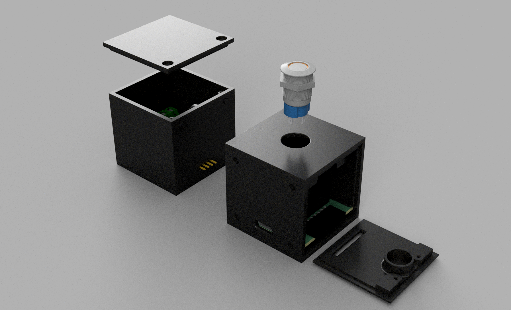
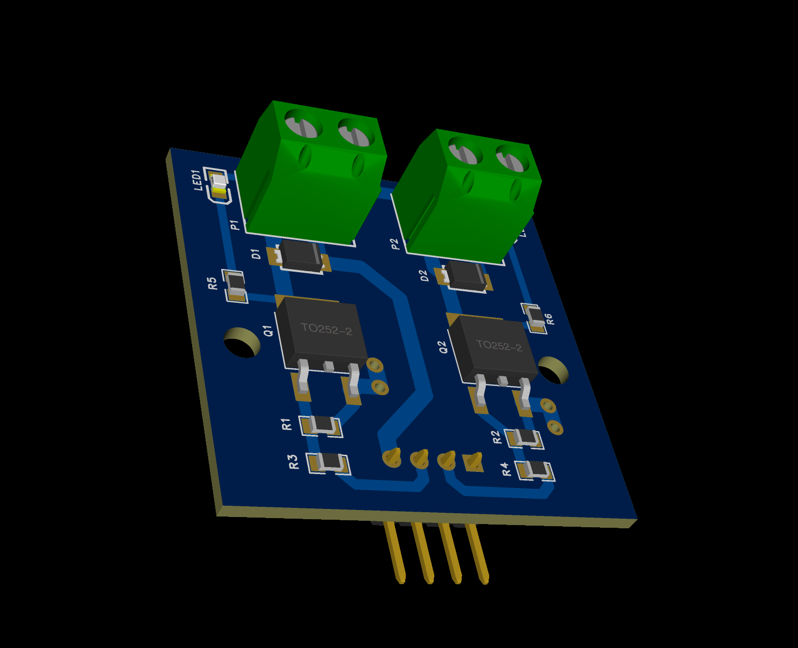

# MyIoT

Модульная IoT-система на отдельных аппаратных кубиках. **Текущий фокус — платы и корпуса Main и Load.**

## Как устроена система

- **Main** — контроллер на ESP32-C3: прошивка, локальные сценарии, Wi-Fi и обмен с сервером/интеграциями.
- **Load** — исполнительный модуль с двумя MOSFET-каналами для совместимых низковольтных DC-нагрузок.
- **Sensors** — будущий модуль для измерений среды.
- **Battery** — будущий модуль автономного питания и энергосбережения.

Все модули подключаются к Main. Main один не выполняет действие с нагрузкой; Main + Load могут управлять каналами локально или по расписанию. Main + Sensors + Load в будущем позволят запускать сценарии по показаниям датчиков. Sensors и Battery пока являются концепциями, а не готовыми платами.





## Важно о статусе и ограничениях

В репозитории есть схемы, PCB/CAD-файлы и рендеры. Это **не подтверждает**, что платы собраны и испытаны как готовый продукт. Для текущей Load-платы пока не установлен рабочий ток; даташит AOD4184 не задаёт рейтинг всей платы. Используйте её только для контролируемых низковольтных DC-испытаний. **Сеть 230 В подключать запрещено.**

Сохранённый внешний модуль IRF520N — отдельный компонент и не равен Load-плате на AOD4184. Успешная проверка одной платы не распространяется на другую. Подробные ограничения и план испытаний — в [обзоре Main и Load](hardware/CUBES.md).

## Структура репозитория

```text
hardware/   схемы, PCB, CAD-модели, материалы и ограничения модулей
firmware/   прошивки и протокол модулей
server/     серверные сервисы
docs/       архитектура, план проекта, безопасность и презентация
```

## Документы

- [Обзор кубиков Main и Load](hardware/CUBES.md)
- [Архитектура системы](docs/ARCHITECTURE.md)
- [Интерфейс модулей](docs/MODULE_INTERFACE.md)
- [План проекта](docs/PROJECT_PLAN.md)
- [Ближайшие шаги](docs/NEXT_STEPS.md)
- [Безопасность](docs/SAFETY.md)
- [Бизнес-оценка и гипотезы](docs/INVESTOR_PLAN.md)
- [Интерактивная презентация](docs/presentation.html) · [PDF](docs/presentation.pdf) · [текст](docs/PRESENTATION.md)
- [3D-концепт автополива](docs/prototype-3d.html) — один из будущих сценариев, не текущий состав аппаратной пары
