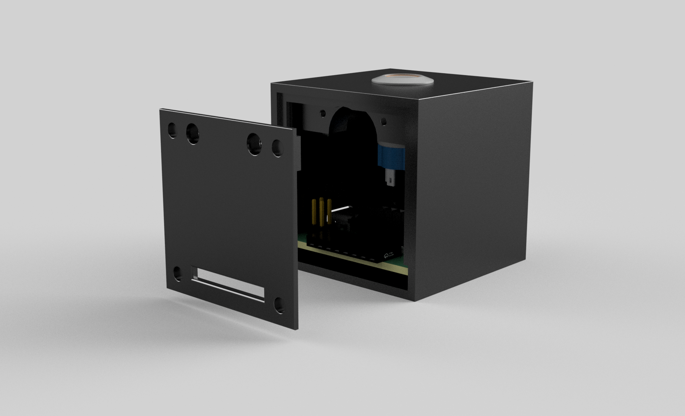
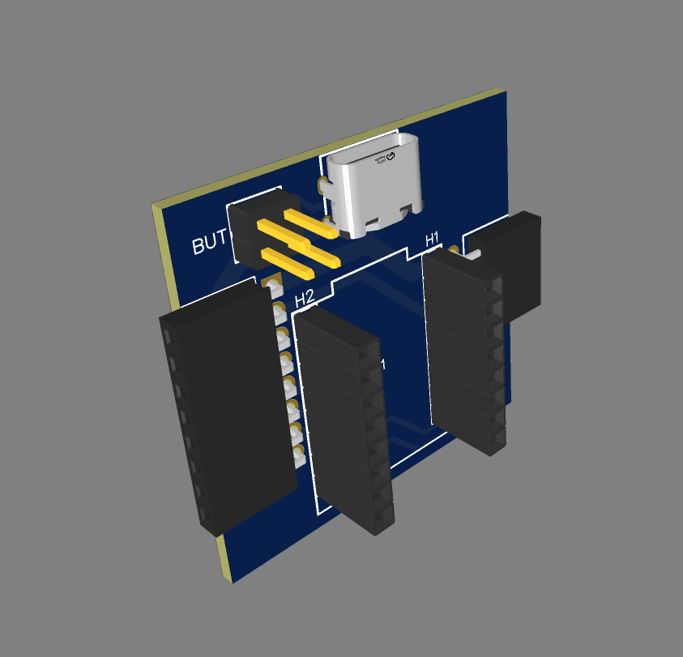
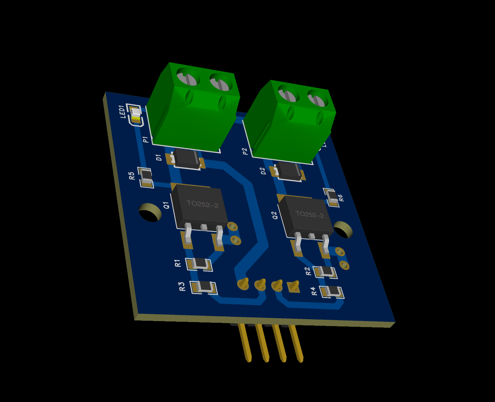
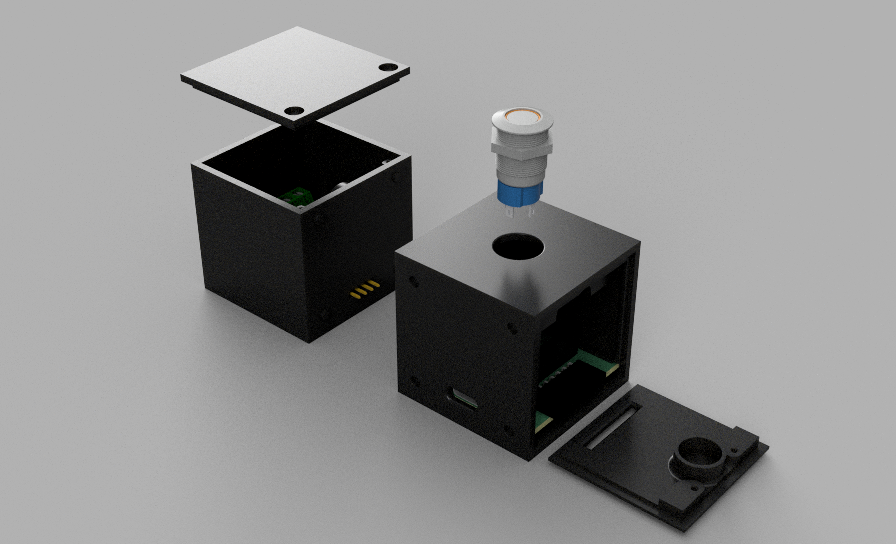

# Аппаратные модули CubeIoT: Main и Load

> **Статус:** проект плат и корпусов. Изображения — CAD-рендеры, а не фотографии собранных и испытанных серийных изделий. Точные номиналы, pinout и допустимые токи должны быть подтверждены перед подключением нагрузки.

CubeIoT строится как система отдельных кубиков. Все модули подключаются к **Main**:

| Кубик | Роль | Статус |
|---|---|---|
| **Main** | Контроллер системы: прошивка, локальная логика, Wi-Fi и обмен с сервером/интеграциями | Есть схема и проект платы/корпуса |
| **Load** | Исполнительный модуль с двумя MOSFET-каналами для DC-нагрузок с целевым питанием 5 В | Есть схема, PCB и 3D-модель платы/корпуса; целевая мощность ещё не испытана |
| **Sensors** | Передаёт Main показания датчиков — например, температуры, влажности, давления, CO₂/CO | Концепция; не входит в текущую пару плат |
| **Battery** | Питает систему от батареи/аккумулятора; потребует отдельного режима энергосбережения | Концепция; схема питания и измерения автономности не подтверждены |

Текущий аппаратный этап — **Main + Load**. Main сам по себе не выполняет полезного сценария: он получает прошивку, принимает команды и координирует модули. В паре Main + Load можно строить сценарии управления совместимой DC-нагрузкой по расписанию, кнопке или данным датчиков после появления Sensors. Облачные сервисы и голосовые ассистенты — интеграции, а не обязательное условие безопасной работы нагрузки.

## Main Cube

**Назначение и состав по схеме/рендеру**

- контроллерный модуль на **ESP32-C3 SuperMini**;
- разъём USB Type-C на плате/узле для подключения USB;
- кнопка, выведенная на корпус; механический файл выбранной кнопки — 12 мм, металлическая, с заявленной защитой от воды (класс защиты корпуса в сборе этим не подтверждается);
- разъёмы/гребёнки для связи с контроллером и подключаемыми модулями.

Main отвечает за выполнение прошивки, локальную автоматику и связь. По предоставленному описанию проекта он должен связывать Load и будущие Sensors/Battery; окончательный протокол, распиновка и обнаружение модулей пока требуют фиксации.

**Ограничения питания и сигналов**

- По замыслу на плату Main подаётся питание 5 В, а отдельный силовой коннектор используется для передачи 5-вольтовой шины на Load. Отдельный коннектор — описание топологии, не доказательство допустимого тока источника или проводников.
- Питать ESP32-C3 SuperMini только через штатный вход USB-C конкретной ревизии платы; ориентир входа — **5 В USB**. Допустимый ток всей платы и проходного питания проектом не подтверждён.
- Не считать, что USB-C/его кабель предназначен для передачи тока Load: силовую подачу и разводку 5 В до отдельного коннектора необходимо сверить со схемой и проверить на сборке.
- Логические сигналы ESP32-C3 — **3,3 В**. Не подавать 5 В или напряжение нагрузки на GPIO.
- GPIO — только сигнал управления, не источник тока для двигателя, световой ленты, реле или иной нагрузки.
- Для платы Main не задан номинальный ток силовой шины/разъёмов. Не считать наличие коннектора подтверждением его мощности.
- Не подключать к Main или его разъёмам сетевое напряжение.

**Файлы:** [схема Main](CubeMain/CubeMainBoard/Schematic_IoTMain_2026-11-10.pdf), [PCB STEP](CubeMain/CubeMainBoard/PCB_Main_2026-11-10.step), [Gerber](CubeMain/CubeMainBoard/Gerber_IoTMain_PCB_IoTMain_2026-11-10.zip), [модель кнопки STEP](CubeMain/12mm%20flat%20Round%20head%20Waterproof%20Momentary%20Latching%20Metal%20Push%20Button%20Switch%20v11.step).

## Load Cube

**Назначение и состав по схеме/рендеру**

- два силовых канала на N-канальных MOSFET **AOD4184** (по одному Q1/Q2 на канал);
- на схеме показаны элементы управления затворами, световая индикация и два выходных клеммника;
- каналами управляет Main; назначение контактов и то, какие типы нагрузки разрешены, должны быть окончательно зафиксированы в интерфейсной спецификации;
- по замыслу силовая шина 5 В идёт к Load через отдельный силовой коннектор, независимо от логических GPIO/сигналов Main;
- плата не является готовым реле, не даёт гальванической развязки и не является модулем для сети 230 В.

### Токи и напряжения: что известно, а что пока нельзя обещать

| Цепь/узел | Ограничение на текущем этапе |
|---|---|
| Входы управления от Main | Проектировать под логику **3,3 В** ESP32-C3; совместимость каждого канала и поведение при старте нужно проверить на собранной плате |
| Целевой режим Load | **5 В, до 50 Вт на канал** по замыслу проекта: `50 Вт / 5 В ≈ 10 А на канал`; при одновременной полной нагрузке двух каналов — около **20 А суммарно** |
| Подтверждённый режим Load | Цель 5 В / 50 Вт на канал **ещё не испытывалась** и не является подтверждённым допустимым рейтингом. Допустимые напряжение, непрерывный ток, пусковой ток и режим обоих каналов одновременно пока не установлены |
| Силовой путь | Отдельный коннектор отделяет силовую шину от GPIO/логических сигналов, но сам по себе не подтверждает токовую способность. Требуют проверки источник 5 В, обе части коннектора, дорожки/проводники Main и Load, кабель, клеммы и элементы коммутации |
| AOD4184 | Даташит компонента задаёт предельные параметры самого транзистора; они не являются рейтингом платы, клемм, дорожек или корпуса |
| Сеть 230 В AC | **Запрещена** для этой платы |

Целевое обозначение «5 В / 50 Вт на канал» — **плановый ориентир**, а не разрешение подключать нагрузку такой мощности до испытаний. Возможность работы на большем токе не определена. Проверку проводить поэтапно после сборки, начиная с ограниченного тока и проверяя каждый канал отдельно, затем оба вместе; критерии и протокол см. в [NEXT_STEPS.md](../docs/NEXT_STEPS.md). Проверить источник 5 В, фактическое напряжение под нагрузкой, падение на силовом тракте, фактическое управление затвором, температуру MOSFET, разъёма, клемм, дорожек и кабеля, а также пуск/переходные процессы. Не назначать рейтинг всей сборки по одному только даташиту транзистора.

**Файлы:** [схема Load](CubeLoad/CubeLoadBoard/SCH_CubelLoad_2026-11-17.pdf), [PCB STEP](CubeLoad/CubeLoadBoard/3D_PCB_Load_2026-11-14.step), [даташит AOD4184](CubeLoad/CubeLoadBoard/AOD4184.PDF).

## Внешний модуль IRF520N — не та же плата

В каталоге также хранится отдельный готовый модуль **IRF520N** и прежняя проверка пользователя: конкретный модуль срабатывал от сигнала 3,3 В и в выключенном состоянии не потреблял ток. Это наблюдение **не переносится** на Load Cube с AOD4184. У IRF520N и AOD4184 разные схемы, характеристики и условия полного открытия; повторная проверка нужна для каждой аппаратной ревизии.

Текстовый файл [заметки о IRF520N](CubeLoad/IRF520N/Характеристики.txt) содержит ориентировочные данные сторонней платы, а не сертифицированный рейтинг. Значения вроде «5 А», «24 В» или заявления о PWM нельзя использовать как утверждённые характеристики Load Cube.

## Корпуса и визуальные материалы

На рендерах видны кубические корпуса, съёмные панели/крышки, размещение платы и внешняя кнопка Main. Это полезно для обсуждения компоновки, но не подтверждает точные размеры, допуски печати, защиту от воды/пыли, вентиляцию, механическую прочность, тепловой режим или удобство монтажа проводов. Эти параметры нужно проверять по STEP-моделям и физической печати.

## Следующие проверки перед заявлением технических характеристик

1. Выпустить BOM и pinout обеих плат с номиналами и полярностью каждого разъёма.
2. Проверить безопасный уровень Load при включении, reset и отключённом Main.
3. Измерить падение напряжения и температуру Load для каждого канала при нескольких DC-нагрузках; поэтапно приблизиться к целевым 5 В / 10 А на канал только после проверки силового тракта; зафиксировать длительный и пусковой ток.
4. Проверить индуктивные выбросы на двигателе/катушке и добавить защиту по итогам review схемы.
5. Проверить USB-питание Main, просадки при Wi-Fi-передаче, нагрев и возможную обратную подачу между разъёмами.
6. Напечатать корпуса, проверить установку платы, кнопку, кабельный ввод, крышки, зазоры и отсутствие контакта с проводниками.
7. После испытаний зафиксировать максимальное рабочее напряжение/ток отдельно для Main, каждого Load-канала и разъёмов; не подменять эти значения абсолютными максимумами компонентов.
